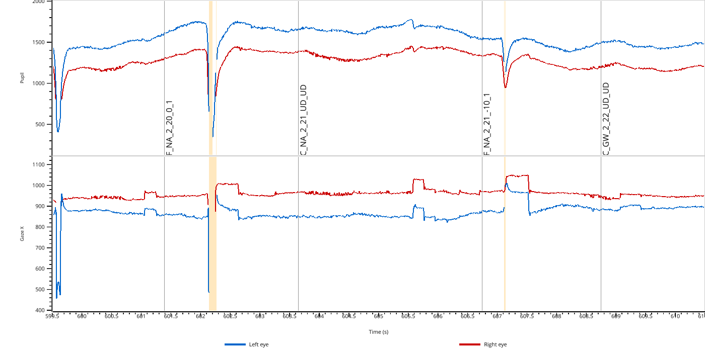

Command-line tools
==================

Three programs are installed together with the package. They give a quick
look at a recording without writing any Python code.

All of them read Eyelink EDF files and eyedata objects saved with
:func:`~pypillometry.write_pickle` or
:meth:`~pypillometry.GenericEyeData.write_file` (e.g., ``.pkl`` or
``.pypil``). The format is detected from the file content, not from the
extension. Instead of a local file, you can also give an HTTP(S) URL or an
SSH URL (``ssh://server/folder/file.edf``).

All three accept ``-q`` (only warnings and errors, no progress bars) and
``-v`` (debug messages, including the output of ``eyelinkio``). Use
``--help`` to see all options.

``pypilview``: look at a recording
----------------------------------

Opens a recording in the interactive :doc:`viewer </user_guide/viewer>`:

.. code-block:: bash

    pypilview recording.edf
    pypilview recording.edf --eyes left --variables pupil
    pypilview preprocessed.pypil

For example, ``pypilview recording.pkl --variables pupil x`` (zoomed in to
ten seconds):

Press :kbd:`H` in the viewer for the keyboard controls. See
:doc:`/user_guide/viewer` for what you can do in the viewer.

``pypilinfo``: summarize files
------------------------------

Prints a summary of one or more files: variables, sampling rate, duration,
events, blinks and the processing history.

.. code-block:: bash

    pypilinfo recording.pkl
    pypilinfo data/*.pkl

For a 40-minute binocular recording:

.. code-block:: text

    $ pypilinfo recording.pkl
    recording.pkl (PICKLE, 11.2 MB)
    EyeData(recording.edf, 124.5MiB):
     n                 : 1245363
     sampling_rate     : 500.0
     eyes              : ['left', 'right']
     data              : ['left_x', 'left_y', 'left_pupil', 'right_x', 'right_y', 'right_pupil']
     nevents           : 1027
     experimental_setup: {'screen_resolution': (1920, 1080), 'physical_screen_size_mm': None, 'eye_to_screen_distance_mm': 'not set', 'camera_position': 'not set'}
     calibration       : {'left': {'n': 9, 'mean': 0.9833, 'sd': 0.3261, 'max': 1.62, 'min': 0.49}, 'right': {'n': 9, 'mean': 0.4956, 'sd': 0.2743, 'max': 0.91, 'min': 0.15}}
     duration_minutes  : 41.5121
     start_min         : 0.0
     end_min           : 41.5121
     params            : {}
     nblinks           : {}
     blinks            : {'left': None, 'right': None}
     glimpse           : EyeDataDict(vars=6,n=1245363,shape=(1245363,)):
      left_x (float64): 817.3, 817.0, 816.7, 816.7, 816.7...
      left_y (float64): 345.2, 343.5, 341.6, 340.4, 340.2...
      left_pupil (float64): 1707.0, 1706.0, 1705.0, 1706.0, 1707.0...
      right_x (float64): 860.6, 860.7, 861.2, 861.7, 861.6...
      right_y (float64): 375.2, 375.9, 376.6, 376.8, 376.9...
      right_pupil (float64): 1738.0, 1739.0, 1739.0, 1740.0, 1742.0...

     Info: 1 keys: eyelink_info
     History:
     *
     └ set_events(Events(1027))

The calibration line shows the validation error (in degrees) for each
eye, and the history lists all processing steps applied to the data so far.

With ``-Q``/``--quality``, ``pypilinfo`` prints a data-quality report
instead of the summary (see :meth:`~pypillometry.GenericEyeData.quality_report`):
missing data, dropouts, noise, gaze precision, calibration errors etc.,
each labeled "good", "ok", "poor" or "bad".

With ``--html``, the quality reports of all files are written to one HTML
page, which is opened in the browser. Use ``-o`` to choose the file name
(default: a temporary file) and ``--no-open`` to only write the file.

.. code-block:: bash

    pypilinfo -Q recording.pkl
    pypilinfo --html data/*.pkl
    pypilinfo --html -o quality.html --no-open data/*.pkl

``edf2pypil``: convert EDF files
--------------------------------

Reading large EDF files takes a while (about a minute for 90 MB).
``edf2pypil`` reads an EDF file once and saves it as a compressed pickle
file that loads much faster:

.. code-block:: text

    $ edf2pypil recording.edf
    pp: 21:38:25 | INFO     | _read_edf:688 | Loading EDF file: recording.edf (current log level: INFO, set to DEBUG to see eyelinkio output)
    pp: 21:38:39 | INFO     | from_eyelink:1297 | Filtering out Eyelink triggers
    Saved recording.pkl

For the 40-minute recording above, this turns a 30 MB EDF file that takes
17 seconds to read into an 11 MB file that loads in under 2 seconds.

More options:

.. code-block:: bash

    edf2pypil recording.edf              # writes recording.pkl
    edf2pypil recording.edf -o rec.pypil
    edf2pypil recording.edf -f           # overwrite an existing file

Load the result in Python with :func:`~pypillometry.read_pickle` or
:meth:`EyeData.from_file() <pypillometry.GenericEyeData.from_file>`.

Eyelink triggers
----------------

By default, Eyelink's own messages (calibration, validation etc.) are
removed from the events when an EDF file is read. Pass ``--keep-triggers``
to keep them.
