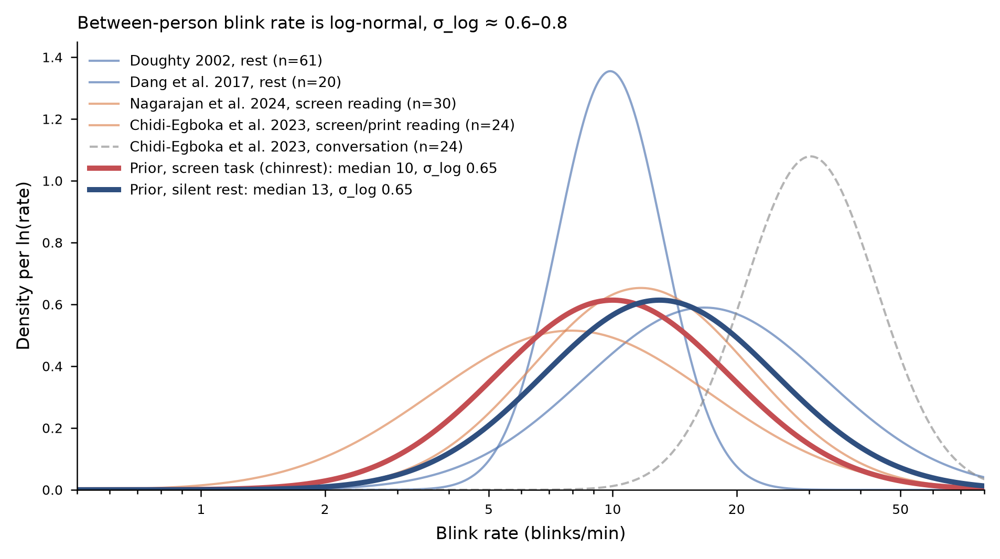

.. currentmodule:: pypillometry

Data quality
============

:meth:`~GenericEyeData.quality_report` summarizes the quality of a
dataset: missing data, dropouts and noise of the pupil, missing and
off-screen samples and precision of the gaze, and agreement between the
eyes. These measures need no preprocessing. After preprocessing, blinks and
masked/interpolated data are reported as well, and calibration errors if
they are available (e.g., from an Eyelink file).

.. code-block:: python

    report = d.quality_report()
    print(report)               # text, colored labels
    print(report.to_text(descriptions=True))
    report                      # HTML table in a notebook
    report.to_dict(flat=True)   # e.g., for a DataFrame
    report.issues()             # "poor" or "bad" measures

From the command line, ``pypilinfo -Q`` prints the report and
``pypilinfo --html`` opens it in a browser (see
:doc:`/getting_started/cli`).

Labels and thresholds
---------------------

Each measure is labeled "good", "ok", "poor" or "bad", and the report has
an overall label (the worst one). A label is assigned by comparing the value
to three bounds ``(good, ok, poor)``: with the bounds ``(5, 15, 30)`` for
missing data, up to 5% is "good", up to 15% "ok", up to 30% "poor" and
anything above "bad". For measures where higher is better (e.g., the
correlation between the eyes), the bounds are decreasing.

.. important::

   The default thresholds are rules of thumb. Some are based on published
   data (blink rate) or on conventions (calibration), but most are
   educated guesses, and where exactly a line is drawn is arbitrary. What
   counts as good data depends on the eye tracker, the population and the
   research question: a study of slow baseline changes tolerates more
   missing data than one of fast, small responses. Use the labels to find
   recordings that need a closer look, not to exclude data automatically,
   and change the thresholds if they do not fit your study.

The thresholds are changed with the ``thresholds`` argument; keys are
``"<section>.<measure>"``, and `None` removes the label:

.. code-block:: python

    d.quality_report(thresholds={"pupil.missing_pct": (2, 10, 20),
                                 "blinks.rate": None})

The defaults are in :data:`pypillometry.quality.DEFAULT_QUALITY_THRESHOLDS`.
The rest of this page explains how they were chosen.

Blink rate
----------

Blink rates differ a lot between people, and the between-person
distribution is skewed: it is approximately log-normal. The figure shows
log-normal distributions fitted to blink rates reported in several studies.
The SD of the log rate is about 0.6--0.8 in most of them. The median is
about 10 blinks/min during reading or a screen task and somewhat higher
during silent rest; during conversation, people blink much more (about 30
blinks/min), but that does not apply to a typical pupillometry experiment.

         with the log-normal priors for screen tasks (median 10/min) and
         silent rest (median 13/min).

For a screen task with a chin rest, a log-normal distribution with median
10 blinks/min and SD 0.65 (of the log rate) describes these data well. The
thresholds for ``blinks.rate`` are 1, 2 and 3 SD above the median, rounded:

=========  ==================  ==========================
label      blink rate          share of people below
=========  ==================  ==========================
good       up to 20/min        ~84% (median + 1 SD)
ok         up to 35/min        ~98% (median + 2 SD)
poor       up to 70/min        ~99.9% (median + 3 SD)
bad        above 70/min
=========  ==================  ==========================

A high blink rate is not a problem in itself, but it means more missing
data, and very high rates often mean that something other than blinks (lost
tracking, a drooping eyelid, glasses) is detected as blinks. A low blink rate
gets no label: some people rarely blink, especially while concentrating.

``blinks.time_pct`` (time in blinks) follows from the rate: a blink,
including the margins that blink detection masks around it, takes roughly
300 ms, so 20 blinks/min take about 10% of the time, 35 blinks/min about 20%
and 70 blinks/min about 35%. The bounds are therefore ``(10, 20, 35)``.

The figure is based on Doughty (2002) and Dang et al. (2017) for rest,
Nagarajan et al. (2024) and Chidi-Egboka et al. (2023) for reading from a
screen or print, and Chidi-Egboka et al. (2023) for conversation.

Blinks also affect the pupil itself. Each blink is followed by a
pulse-like pupil response, a constriction followed by a dilation, of
substantial size and duration (Yoo, Ahn, & Lee, 2021). Interpolating the missing samples during the blink does not
remove this response. Because blinking depends on the task (people blink
less while they concentrate and more after a response or at the end of a
trial), the blink-locked response can differ between experimental
conditions and be mistaken for an effect of the condition. A blink rate in
the "good" range does not rule this out: if blinks are frequent or their
timing differs between conditions, check the blink rate per condition, and
consider modeling or removing the blink-locked response (Yoo et al., 2021).

Pupil
-----

``pupil.missing_pct`` ``(5, 15, 30)``
    Blinks alone make about 3--5% of the samples missing at a normal blink
    rate (10 blinks/min of ~300 ms each). Up to 5% is therefore what a
    well-tracked recording looks like, and up to 15% is still common.
    Above 30%, a large part of the data has to be interpolated or is lost,
    and many studies would consider excluding the trial or participant.

``pupil.dropout_rate`` ``(20, 35, 70)``
    In raw data, most dropouts are blinks, so the bounds are the same as for
    the blink rate. More dropouts than blinks can explain point to unstable
    tracking.

``pupil.longest_dropout`` ``(1, 3, 10)`` seconds
    Blinks rarely last longer than 0.5 s. A dropout longer than 1 s is
    something else (eyes closed, looking away, head movement), and gaps of
    several seconds cannot be interpolated sensibly and may take out whole
    trials.

``pupil.noise`` ``(0.5, 1, 2)`` % of the median pupil size
    The sample-to-sample noise of a video eye tracker is usually a fraction
    of a percent of the pupil size. Task-evoked dilations are often only a
    few percent, so noise of more than 1--2% per sample makes small effects
    hard to see without heavy filtering. These bounds are guesses; noise
    depends a lot on the tracker and the sampling rate.

Gaze
----

``gaze.missing_pct``, ``gaze.dropout_rate``, ``gaze.longest_dropout``
    Same bounds and reasoning as for the pupil.

``gaze.offscreen_pct`` ``(5, 15, 30)`` % of valid samples
    In a screen experiment, participants should look at the screen.
    Off-screen samples come from looking away or from a calibration that is
    off. The bounds are the same as for missing data, because these samples
    are usually unusable as well. This needs the screen size (see
    :meth:`~GazeData.set_experimental_setup`).

``gaze.precision_deg`` ``(0.05, 0.1, 0.2)`` degrees
    The median distance between consecutive samples (sample-to-sample
    precision). Tower-mounted and desktop video eye trackers typically
    achieve a few hundredths of a degree with a chin rest (Holmqvist,
    Nyström, & Mulvey, 2012). Values of 0.1--0.2° or more suggest a poor
    pupil or corneal reflection image, or head movement. The value depends
    on the sampling rate and the tracker's filters, so compare it between
    recordings of the same setup. Without screen size and eye distance the
    precision is reported in pixels without a label.

Both eyes
---------

``binocular.pupil_correlation`` ``(0.9, 0.8, 0.6)``
    The pupils of both eyes respond together (the light reflex is
    consensual), so their sizes should be very highly correlated. A lower
    correlation usually means that one eye was tracked poorly.

``binocular.gaze_disparity_deg`` ``(1, 2, 3)`` degrees
    Both eyes look at the same point, apart from small vergence differences.
    With a calibration accuracy of about 0.5° per eye, disparities up to 1°
    are expected. Larger disparities point to a calibration problem in one
    eye.

Preprocessing
-------------

``artifacts.pupil_masked_pct``, ``artifacts.gaze_masked_pct`` ``(10, 20, 35)``
    The share of samples that preprocessing masked (blinks with their
    margins and other artifacts). The bounds match those for the time in
    blinks: masking only the blinks of a typical recording gives about 5--10%.

``artifacts.interpolated_pct`` ``(10, 20, 30)``
    Interpolated data are an estimate, not a measurement. If more than
    20--30% of the data is interpolated, results depend heavily on the
    interpolation.

Calibration
-----------

``calibration.mean_error`` ``(0.5, 1.0, 1.5)``, ``calibration.max_error`` ``(1.0, 1.5, 2.0)`` degrees
    The first two bounds follow the Eyelink validation ratings: GOOD with a
    mean error up to 0.5° and a maximum error up to 1°, FAIR up to 1° and
    1.5°. The third bound (between "poor" and "bad") is our choice.

References
----------

Chidi-Egboka, N. C., Jalbert, I., Chen, J., Briggs, N. E., & Golebiowski,
B. (2023). Blink rate measured in situ decreases while reading from printed
text or digital devices, regardless of task duration, difficulty, or viewing
distance. *Investigative Ophthalmology & Visual Science*, 64(2), 14.
https://doi.org/10.1167/iovs.64.2.14

Dang, L. C., Samanez-Larkin, G. R., Castrellon, J. J., Perkins, S. F.,
Cowan, R. L., Newhouse, P. A., & Zald, D. H. (2017). Spontaneous eye blink
rate (EBR) is uncorrelated with dopamine D2 receptor availability and
unmodulated by dopamine agonism in healthy adults. *eNeuro*, 4(5),
ENEURO.0211-17.2017. https://doi.org/10.1523/ENEURO.0211-17.2017

Doughty, M. J. (2002). Further assessment of gender- and blink
pattern-related differences in the spontaneous eyeblink activity in primary
gaze in young adult humans. *Optometry and Vision Science*, 79(7),
439--447. https://doi.org/10.1097/00006324-200207000-00013

Holmqvist, K., Nyström, M., & Mulvey, F. (2012). Eye tracker data quality:
What it is and how to measure it. In *Proceedings of the Symposium on Eye
Tracking Research and Applications (ETRA '12)* (pp. 45--52).
https://doi.org/10.1145/2168556.2168563

Nagarajan, K., Ravi, K., Periakaruppan, S. P., & Satgunam, P. (2024). When
noise becomes signal: A study of blink rate using an eye tracker. *The
Ocular Surface*, 34, 516--520. https://doi.org/10.1016/j.jtos.2024.11.002

Yoo, K., Ahn, J., & Lee, S.-H. (2021). The confounding effects of eye
blinking on pupillometry, and their remedy. *PLOS ONE*, 16(12), e0261463.
https://doi.org/10.1371/journal.pone.0261463
