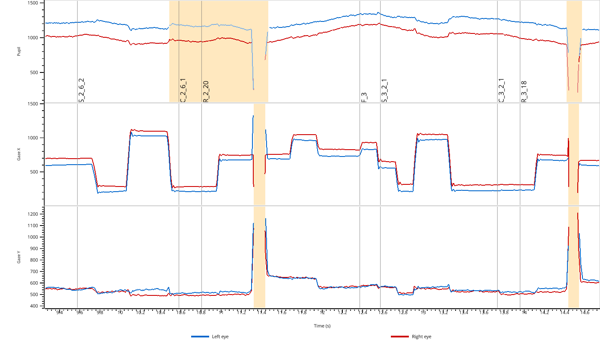
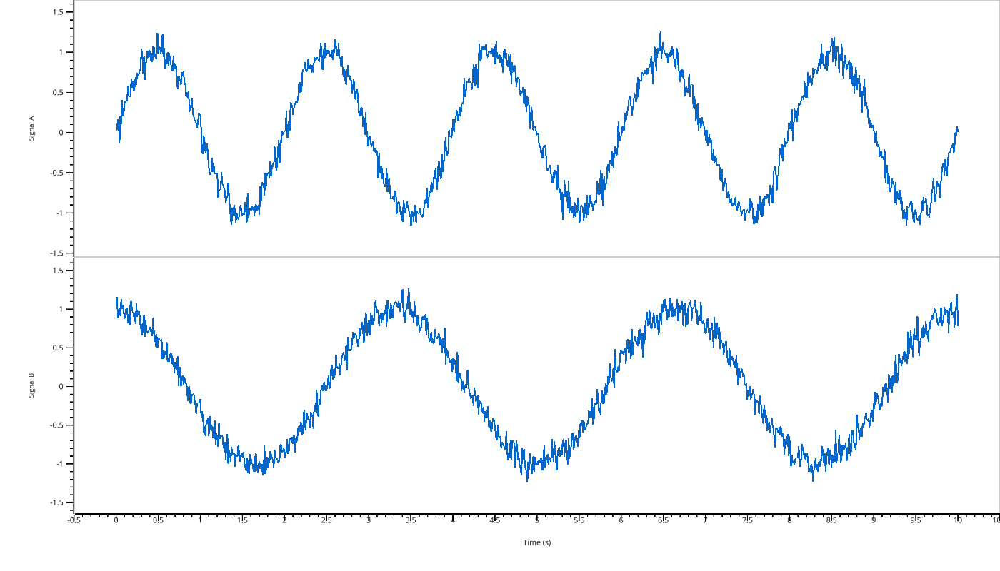
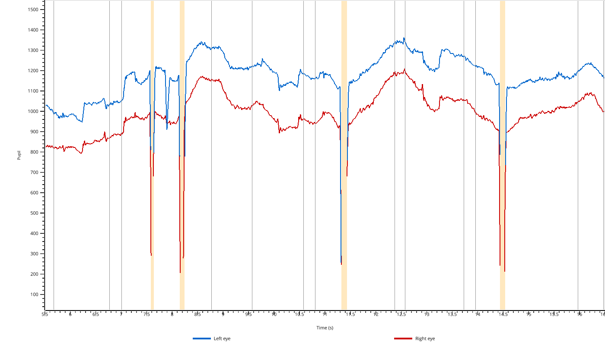
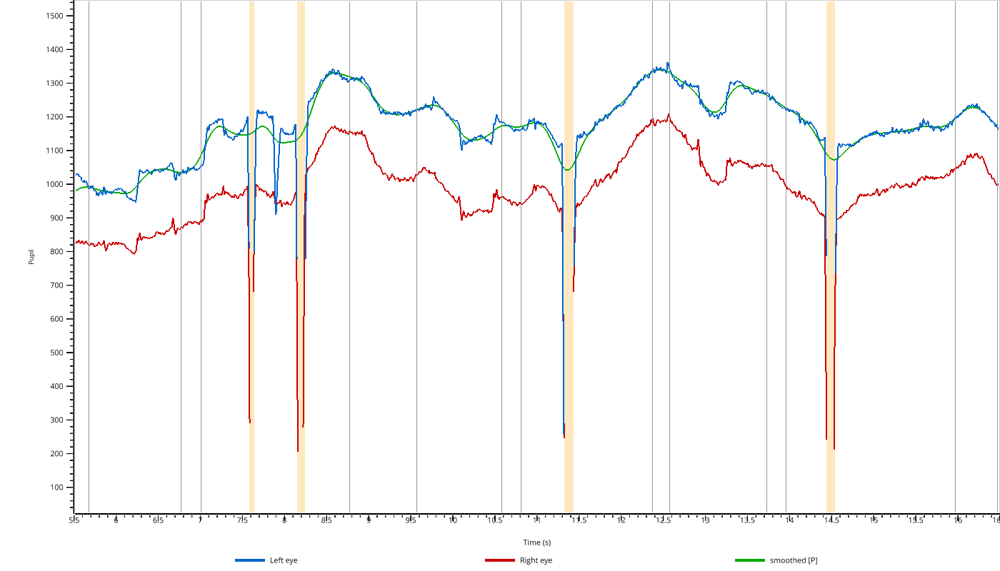
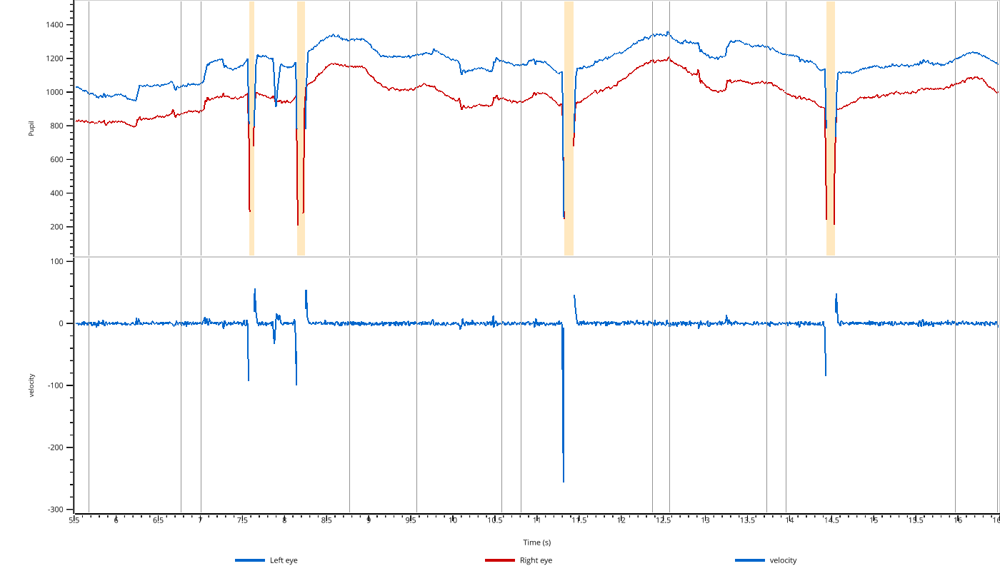

.. currentmodule:: pypillometry

GPU-Accelerated Viewer (pp.view)
================================

The :func:`view` function provides a GPU-accelerated interactive viewer for exploring eye-tracking data. It is designed for smooth navigation of long recordings (60+ minutes at 1000 Hz) using VisPy for OpenGL rendering.

**Keyboard shortcuts:** Press ``H`` or ``?`` in the viewer to see all available keyboard shortcuts for navigation, zooming, and toggling display options.

Viewing EyeData Objects
-----------------------

The simplest use case is viewing an :class:`EyeData` object directly:

.. code-block:: python

    import pypillometry as pp

    eyedata = pp.get_example_data("rlmw_002_short")
    pp.view(eyedata)

The viewer automatically creates subplots for each modality (pupil, x, y) and shows both left (blue) and right (red) eye data. Masked regions are highlighted in orange.

Viewing Numpy Arrays
--------------------

You can also view raw numpy arrays. Use a dictionary to create multiple subplots:

.. code-block:: python

    import numpy as np
    import pypillometry as pp

    # Create synthetic signals
    t = np.linspace(0, 10, 1000)
    signal_a = np.sin(2 * np.pi * 0.5 * t) + np.random.randn(1000) * 0.1
    signal_b = np.cos(2 * np.pi * 0.3 * t) + np.random.randn(1000) * 0.1

    pp.view({"Signal A": signal_a, "Signal B": signal_b}, time=t)

Filtering Variables
-------------------

For EyeData objects, you can filter which modalities to display using the ``variables`` parameter:

.. code-block:: python

    import pypillometry as pp

    eyedata = pp.get_example_data("rlmw_002_short")
    pp.view(eyedata, variables=['pupil'])

Valid values are ``'pupil'``, ``'x'``, and ``'y'``. Similarly, ``eyes`` selects the eyes to display (default: all available eyes):

.. code-block:: python

    pp.view(eyedata, variables=['pupil'], eyes=['left'])

Adding Overlays
---------------

You can overlay additional data on top of the main plots for comparison. This is useful for visualizing the effect of processing steps:

.. code-block:: python

    import numpy as np
    import pypillometry as pp

    eyedata = pp.get_example_data("rlmw_002_short")
    
    # Create a smoothed version of the pupil signal
    pupil = np.array(eyedata['left_pupil'])
    kernel = np.ones(50) / 50
    smoothed = np.convolve(pupil, kernel, mode='same')
    
    pp.view(eyedata, variables=['pupil'], overlay_pupil={'smoothed': smoothed})

Use ``overlay_pupil``, ``overlay_x``, or ``overlay_y`` to add overlays to the respective subplots.

Extra Subplots
--------------

You can add additional subplots below the main EyeData variables using ``extra_plots``:

.. code-block:: python

    import numpy as np
    import pypillometry as pp

    eyedata = pp.get_example_data("rlmw_002_short")
    
    # Compute velocity (derivative of pupil size)
    pupil = np.array(eyedata['left_pupil'])
    velocity = np.gradient(pupil)
    
    pp.view(eyedata, variables=['pupil'], extra_plots={'velocity': velocity})

Highlighting Intervals
----------------------

Use ``highlight`` to shade :class:`Intervals` (e.g., detected blinks) in the plots, and ``highlight_color`` to change their color (default ``'lightblue'``):

.. code-block:: python

    import pypillometry as pp

    eyedata = pp.get_example_data("rlmw_002_short")
    blinks = eyedata.pupil_blinks_detect(eyes='left')  # Intervals

    # same intervals in all subplots
    pp.view(eyedata, highlight=blinks, highlight_color='orange')

    # or per subplot
    pp.view(eyedata, highlight={'pupil': blinks})

``highlight`` is either a single :class:`Intervals` object (shown in all subplots) or a dict mapping subplot keys to :class:`Intervals`. The keys are ``'pupil'``, ``'x'``, ``'y'`` and ``'extra_<label>'`` for ``extra_plots`` (EyeData), or the plot labels (arrays). Intervals in time units are converted to seconds, sample-index Intervals are placed using the time vector.

Interactive Selection
---------------------

The viewer supports interactive region selection:

1. Press ``S`` to enter selection mode
2. Click and drag to select a region
3. Press ``D`` or ``Backspace`` to remove the last selection
4. When you close the viewer, selected regions are returned as :class:`Intervals` objects

.. code-block:: python

    import pypillometry as pp

    eyedata = pp.get_example_data("rlmw_002_short")
    
    # View data and select regions
    selections = pp.view(eyedata, variables=['pupil'])
    
    # selections is a dict of Intervals if any regions were selected
    if selections:
        print(selections)

The returned dict has the same keys as ``highlight`` (``'pupil'``, ``'x'``, ``'y'``, ``'extra_<label>'`` or the plot labels for arrays). The Intervals are in seconds (``units='sec'``); for raw arrays without ``time`` they are sample indices (``units=None``). If no region was selected, :func:`view` returns ``None``.

API Reference
-------------

.. autofunction:: view

